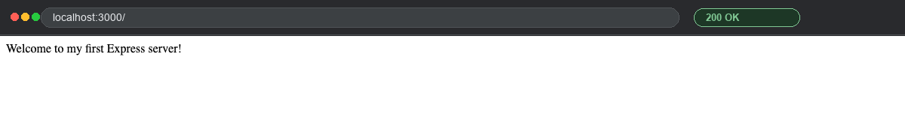
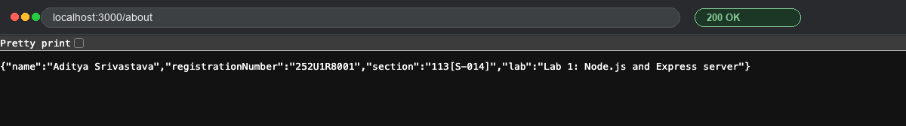
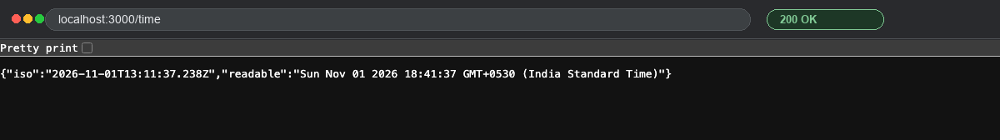
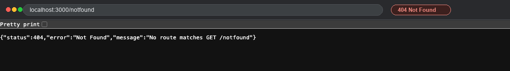
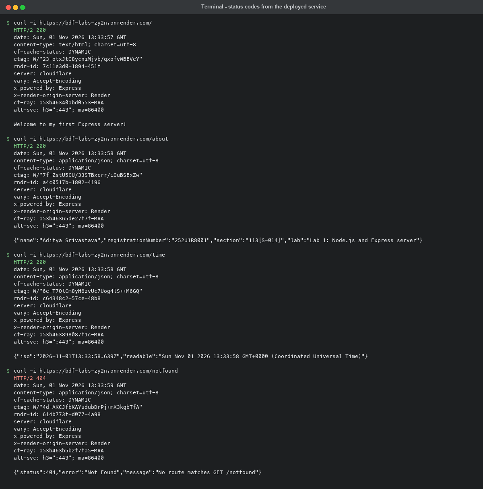

# Lab 1: Node.js and Express server

**Aditya Srivastava** · **252U1R8001** · Section **113[S-014]**
Backend Development Fundamentals · Year II Term II · Aurora
Faculty: Joel Prashanth D

## Live link

_Deploying — paste the Render URL here once the service is live._

The repository root has a [`render.yaml`](../render.yaml) blueprint, so Render
creates the service with no manual configuration: **New → Blueprint → pick this
repository**. Note that the free plan sleeps when idle, so the first request
after a quiet spell takes a few seconds to wake the service.

Every endpoint below is also evidenced by the screenshots in
[`screenshots/`](screenshots), captured against the server running locally on
port 3000.

## How to run

```bash
cd lab-01
npm install
npm start
```

The server then listens on <http://localhost:3000>.

| Script | Command | What it runs |
| --- | --- | --- |
| `npm start` | `node server.js` | The Express server (Tasks 4–6) |
| `npm run start:http` | `node basic-server.js` | The plain `http` server (Task 3) |

**Environment variables:** only `PORT` is read, and it is optional — the server
falls back to `3000` when it is not set. There is no `.env` file in this lab,
and no secrets of any kind.

```bash
PORT=4000 npm start   # example: run on a different port
```

## Endpoints

| Method | Path | Description | Status |
| --- | --- | --- | --- |
| GET | `/` | Plain-text welcome message | 200 |
| GET | `/about` | JSON with my name, registration number and section | 200 |
| GET | `/time` | JSON with the current date and time from `new Date()` | 200 |
| GET | _anything else_ | JSON 404 message from the catch-all handler | 404 |

## Screenshots

**`GET /` — 200**



**`GET /about` — 200**



**`GET /time` — 200**



**`GET /notfound` — 404**



**Status code for every route (`curl -i`)**



## Task 1 — the fields of `package.json`

```json
{
  "name": "lab-01",
  "version": "1.0.0",
  "description": "Lab 1 - Node.js and Express server (Backend Development Fundamentals)",
  "main": "server.js",
  "scripts": { "start": "node server.js", "start:http": "node basic-server.js" },
  "keywords": ["nodejs", "express", "lab-01"],
  "author": "Aditya Srivastava (252U1R8001)",
  "license": "ISC",
  "type": "commonjs",
  "dependencies": { "express": "^5.3.0" },
  "engines": { "node": ">=18" }
}
```

| Field | What it is for |
| --- | --- |
| `name` | The package's name. Must be lowercase with no spaces; it is what npm would publish it under. |
| `version` | The package's own version, in semver form `major.minor.patch`. |
| `description` | One line saying what the project does. Shown on the npm page and in search results. |
| `main` | The file `require("lab-01")` would load — the entry point of the package. |
| `scripts` | Named shortcuts run with `npm run <name>`. `start` and `test` can be run as `npm start` / `npm test`. |
| `keywords` | Search terms for npm. No effect on how the code runs. |
| `author` | Who wrote it. |
| `license` | The terms the code is released under. `ISC` is npm's default. |
| `type` | The module system for `.js` files — `commonjs` (`require`) or `module` (`import`). |
| `dependencies` | Packages the project needs **at runtime**, with the version range allowed. `^5.3.0` means "5.3.0 or newer, but below 6.0.0". npm installs these into `node_modules`. |
| `engines` | The Node versions the project supports. I added this by hand so the host (Render) picks a modern Node rather than guessing. |

`npm init -y` writes this file with defaults and no questions asked. The
`dependencies` entry appeared by itself when I ran `npm install express`.

## Task 2 — where Express lives

`npm install express` created `node_modules/` and put the package in
`node_modules/express/` (its code is in `node_modules/express/lib`, its entry
point is `node_modules/express/index.js`). Express's own dependencies were
installed alongside it — 65 packages in total — and `package-lock.json` records
the exact version of every one of them.

## Task 7 — status code for every route

| Request | Status | Content-Type |
| --- | --- | --- |
| `GET /` | `200 OK` | `text/html; charset=utf-8` |
| `GET /about` | `200 OK` | `application/json; charset=utf-8` |
| `GET /time` | `200 OK` | `application/json; charset=utf-8` |
| `GET /notfound` | `404 Not Found` | `application/json; charset=utf-8` |

Verified with `curl -i` (screenshot 05) and by opening each route in the
browser.

## Viva questions

**What is the difference between `package.json` and `node_modules`?**
`package.json` is a small text file I write and commit: it *declares* what the
project is and which packages it needs, by version range. `node_modules/` is
the folder npm *generates* from that declaration — the actual downloaded code
of every dependency and sub-dependency, thousands of files. The first is the
recipe, the second is the meal. `node_modules` is never committed (it is in
`.gitignore`); anyone who clones the repo runs `npm install` and npm rebuilds
it from `package.json` and `package-lock.json`.

**What does `app.listen` do?**
It starts the HTTP server and binds it to a port, so the operating system
starts handing incoming TCP connections on that port to my process. Until
`app.listen(3000)` runs, the routes exist as definitions but nothing is
reachable. It is asynchronous — the optional callback fires once the server is
actually listening, which is why the "listening on…" message is printed from
inside it. It returns the underlying `http.Server` object.

**What do `request` and `response` represent?**
`request` is the incoming message from the client — the method, the URL, the
headers, the query string, the body. I read from it to decide what the client
wants (for example `request.originalUrl` in my 404 handler). `response` is the
reply I am building and is write-only — I set the status with
`response.status(...)` and send the body with `.send()` or `.json()`, which
ends the response. One request in, one response out, per connection.

## Notes — problems faced and how I solved them

- **The 404 catch-all.** My first instinct was `app.get("*", ...)`. That throws
  on Express 5, because it now uses `path-to-regexp` v8, where a bare `*` is no
  longer a valid pattern (it wants a named wildcard like `*splat`). Using
  `app.use(...)` with no path is simpler and works on both Express 4 and 5: it
  runs for any method and any path, but only after all the real routes above it
  have failed to match, so order matters — it has to be the last handler.

- **Route order in general.** Express tries handlers top to bottom and stops at
  the first one that answers. Putting the catch-all above `/about` would have
  made every route return 404.

- **`/` reports `text/html`, not `text/plain`.** `response.send()` with a string
  sets `text/html` by default. The plain `http` version sets the header
  by hand, so it really is `text/plain`. Worth knowing when the content type
  matters.
